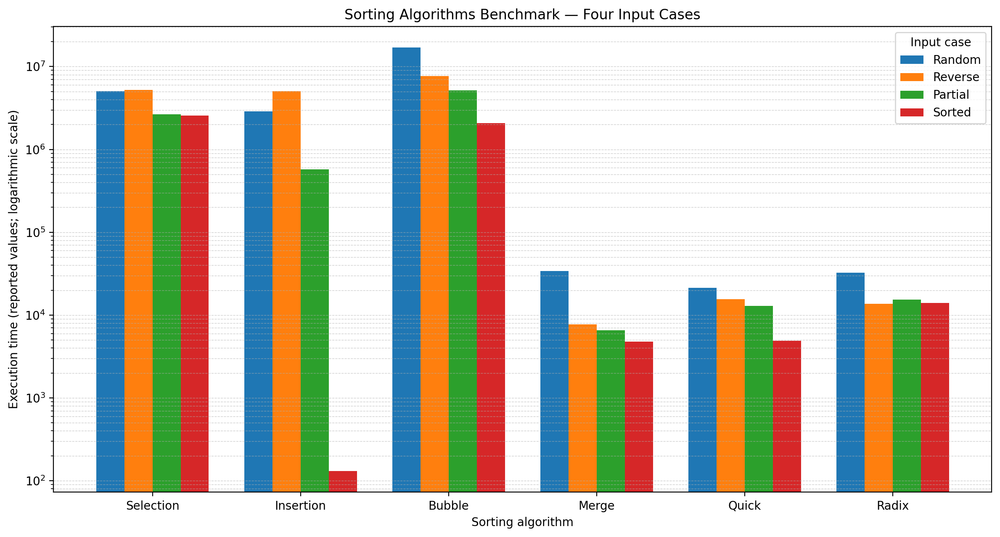

# مشروع مقارنة أداء خوارزميات الترتيب
# Sorting Algorithms Benchmark

مشروع بلغة Java يهدف إلى مقارنة أداء ست خوارزميات مختلفة للترتيب (Sorting Algorithms)، من خلال قياس زمن التنفيذ باستخدام أربعة أنواع مختلفة من البيانات، وتحليل تأثير ترتيب البيانات على كفاءة كل خوارزمية.

---

## 1. معلومات الطالب (Student Information)

- **اسم الطالب:** ثراء الغنمة
- **الرقم الجامعي:**3166101 
- **رقم المجموعة:** DSA Group C
- **لغة البرمجة:** Java
- **حجم المصفوفة:** 100,000 عدد صحيح (Integers)

---

## 2. وصف المشروع (Project Description)

يهدف هذا المشروع إلى دراسة ومقارنة أداء ست خوارزميات للترتيب، من خلال اختبارها على أربعة أنواع مختلفة من البيانات، وقياس الزمن الذي تستغرقه كل خوارزمية لإتمام عملية الترتيب.

### خوارزميات الترتيب (Sorting Algorithms)

1. Selection Sort – الترتيب بالاختيار.
2. Insertion Sort – الترتيب بالإدراج.
3. Bubble Sort – الترتيب بالفقاعات.
4. Merge Sort – الترتيب بالدمج.
5. Quick Sort – الترتيب السريع.
6. Radix Sort – الترتيب حسب الخانات الرقمية.

### أنواع البيانات المستخدمة في الاختبار (Input Cases)

- **Random (بيانات عشوائية):** أعداد مرتبة بشكل عشوائي.
- **Reverse Sorted (بيانات عكسية):** أعداد مرتبة من الأكبر إلى الأصغر.
- **Partially Sorted (بيانات مرتبة جزئياً):** بيانات مرتبة مسبقاً مع إجراء بعض التبديلات العشوائية.
- **Fully Sorted (بيانات مرتبة بالكامل):** أعداد مرتبة من الأصغر إلى الأكبر.

---

## 3. منهجية التجربة (Experimental Method)

يستخدم البرنامج الدالة `System.nanoTime()` من مكتبة Java لقياس الزمن المستغرق في تنفيذ كل خوارزمية.

### حساب زمن التنفيذ

يتم حساب زمن التنفيذ بالصيغة التالية:

```java
Execution Time (ns) = End Time - Start Time;
```

حيث:

- **Start Time:** وقت بداية تنفيذ الخوارزمية.
- **End Time:** وقت انتهاء تنفيذ الخوارزمية.
- **Execution Time:** الزمن المستغرق في تنفيذ عملية الترتيب.

### خطوات إجراء التجربة

1. إنشاء مصفوفة تحتوي على 100,000 عدد صحيح.
2. تجهيز أربعة أنواع مختلفة من البيانات للاختبار.
3. إعطاء كل خوارزمية نسخة مستقلة من المصفوفة الأصلية.
4. استبعاد زمن نسخ المصفوفة من عملية قياس الأداء.
5. تنفيذ عمليات إحماء (Warm-up Runs) قبل القياس.
6. تكرار عملية القياس سبع مرات لكل حالة.
7. استخدام القيمة الوسطى (Median) للقياسات باعتبارها النتيجة النهائية.
8. التحقق من أن المصفوفة أصبحت مرتبة بشكل صحيح بعد التنفيذ.

---

## 4. نتائج التجارب (Benchmark Results)

يوضح الجدول التالي النتائج الفعلية لقياس زمن تنفيذ خوارزميات الترتيب الست باستخدام أنواع البيانات الأربعة.

**حجم المصفوفة:** 100,000 عنصر.

**وحدة القياس:** النانوثانية (Nanoseconds - ns).

| الخوارزمية | عشوائي (Random) | عكسي (Reverse) | جزئي (Partial) | مرتب (Sorted) |
|---|---:|---:|---:|---:|
| Selection Sort | 5,074,553 | 5,209,540 | 2,647,890 | 2,554,101 |
| Insertion Sort | 2,888,023 | 5,074,330 | 575,420 | 131 |
| Bubble Sort | 16,985,444 | 7,670,840 | 5,180,551 | 2,079,487 |
| Merge Sort | 33,999 | 7,764 | 6,585 | 4,800 |
| Quick Sort | 21,296 | 15,619 | 12,971 | 4,902 |
| Radix Sort | 32,297 | 13,620 | 15,354 | 14,064 |

---
##  التمثيل البياني للنتائج (Benchmark Visualization)

يوضح الرسم البياني مقارنة زمن التنفيذ بين خوارزميات الترتيب الست في حالات الاختبار الأربع.


## 5. تحليل أداء الخوارزميات (Performance Analysis)

### 5.1 خوارزمية Selection Sort

تعتمد خوارزمية Selection Sort على البحث عن أصغر عنصر في الجزء غير المرتب من المصفوفة، ثم وضعه في موقعه الصحيح.

تستمر العملية حتى يتم ترتيب جميع العناصر.

**التعقيد الزمني (Time Complexity):**

- أفضل حالة: O(N²)
- متوسط الحالة: O(N²)
- أسوأ حالة: O(N²)

**التعقيد المكاني (Space Complexity):** O(1)

تتميز هذه الخوارزمية بأن عدد المقارنات يظل تقريباً ثابتاً بغض النظر عن الترتيب الأولي للبيانات، كما أنها تنفذ عدداً قليلاً نسبياً من عمليات التبديل.

### 5.2 خوارزمية Insertion Sort

تعتمد خوارزمية Insertion Sort على بناء جزء مرتب من المصفوفة، وذلك عن طريق إدراج كل عنصر في موقعه الصحيح مقارنة بالعناصر السابقة.

**التعقيد الزمني (Time Complexity):**

- أفضل حالة: O(N)
- متوسط الحالة: O(N²)
- أسوأ حالة: O(N²)

**التعقيد المكاني (Space Complexity):** O(1)

تتميز هذه الخوارزمية بأدائها الجيد عندما تكون البيانات مرتبة مسبقاً أو شبه مرتبة.

وتظهر نتائج التجربة تفوقها بشكل واضح عند التعامل مع البيانات المرتبة بالكامل.

### 5.3 خوارزمية Bubble Sort

تعتمد خوارزمية Bubble Sort على مقارنة كل عنصر بالعنصر المجاور له، وتبديل موقعيهما إذا كانا في ترتيب غير صحيح.

تتكرر العملية حتى تصبح جميع العناصر مرتبة.

**التعقيد الزمني (Time Complexity):**

- أفضل حالة: O(N²) في التطبيق المستخدم.
- متوسط الحالة: O(N²)
- أسوأ حالة: O(N²)

**التعقيد المكاني (Space Complexity):** O(1)

تعتبر Bubble Sort من الخوارزميات البسيطة، لكنها قد تكون بطيئة جداً عند التعامل مع المصفوفات الكبيرة بسبب العدد الكبير من المقارنات وعمليات التبديل.

### 5.4 خوارزمية Merge Sort

تعتمد خوارزمية Merge Sort على أسلوب تقسيم المشكلة وحلها (Divide and Conquer).

تقوم بتقسيم المصفوفة إلى أجزاء أصغر، ثم ترتيب كل جزء بشكل مستقل، وبعد ذلك دمج الأجزاء المرتبة للحصول على مصفوفة مرتبة بالكامل.

**التعقيد الزمني (Time Complexity):**

- أفضل حالة: O(N log N)
- متوسط الحالة: O(N log N)
- أسوأ حالة: O(N log N)

**التعقيد المكاني (Space Complexity):** O(N)

تتميز Merge Sort بأداء ثابت نسبياً، بغض النظر عن الترتيب الأولي للبيانات.

وقد حققت أفضل النتائج في تجربتنا مع البيانات العكسية والمرتبة جزئياً.

### 5.5 خوارزمية Quick Sort

تعتمد خوارزمية Quick Sort أيضاً على أسلوب Divide and Conquer.

تقوم باختيار عنصر يسمى Pivot (المحور)، ثم تقسيم المصفوفة إلى قسمين:

- العناصر الأصغر من أو المساوية للمحور.
- العناصر الأكبر من المحور.

بعد ذلك يتم تطبيق الخوارزمية بشكل تكراري على القسمين.

**التعقيد الزمني (Time Complexity):**

- أفضل حالة: O(N log N)
- متوسط الحالة: O(N log N)
- أسوأ حالة: O(N²)

**التعقيد المكاني (Average Auxiliary Space Complexity):** O(log N)

استخدام محور عشوائي (Randomized Pivot) يساعد على تقليل احتمالية حدوث تقسيمات غير متوازنة باستمرار.

وقد حققت Quick Sort أفضل أداء في تجربتنا مع البيانات العشوائية.

### 5.6 خوارزمية Radix Sort

تعتبر Radix Sort خوارزمية ترتيب غير معتمدة على المقارنة (Non-Comparison Sorting Algorithm).

تعتمد على ترتيب الأعداد خانة بخانة، بداية من الخانة الأقل أهمية (Least Significant Digit - LSD) وصولاً إلى الخانة الأعلى أهمية (Most Significant Digit - MSD).

تستخدم الخوارزمية أسلوب ترتيب مستقر (Stable Sorting) في كل مرحلة، مثل Counting Sort.

**التعقيد الزمني (Time Complexity):**

O(D × (N + B))

**التعقيد المكاني (Space Complexity):**

O(N + B)

حيث:

- N = عدد العناصر في المصفوفة.
- D = عدد الخانات الرقمية في أكبر عدد.
- B = عدد القيم الرقمية الممكنة، ويساوي 10 في النظام العشري.

يمكن أن تكون Radix Sort فعالة عند ترتيب الأعداد الصحيحة التي تحتوي على عدد محدود من الخانات الرقمية.

---

## 6. مقارنة التعقيد الزمني والمكاني (Complexity Comparison)

يوضح الجدول التالي مقارنة بين الخوارزميات الست من حيث التعقيد الزمني والمكاني.

| الخوارزمية | أفضل حالة | متوسط الحالة | أسوأ حالة | التعقيد المكاني |
|---|---|---|---|---|
| Selection Sort | O(N²) | O(N²) | O(N²) | O(1) |
| Insertion Sort | O(N) | O(N²) | O(N²) | O(1) |
| Bubble Sort | O(N²) | O(N²) | O(N²) | O(1) |
| Merge Sort | O(N log N) | O(N log N) | O(N log N) | O(N) |
| Quick Sort | O(N log N) | O(N log N) | O(N²) | O(log N) متوسط |
| Radix Sort | O(D(N+B)) | O(D(N+B)) | O(D(N+B)) | O(N+B) |

ملاحظة: تعقيد Bubble Sort في هذا الجدول يخص التطبيق المستخدم دون تحسين التوقف المبكر (Early Stop Optimization).

---

## 7. أفضل خوارزمية في كل حالة (Best Performing Algorithm)

بناءً على نتائج التجارب، تم تحديد الخوارزمية الأسرع في كل حالة من حالات الاختبار.

| نوع البيانات | أفضل خوارزمية | زمن التنفيذ (ns) |
|---|---|---:|
| Random | Quick Sort | 21,296 |
| Reverse Sorted | Merge Sort | 7,764 |
| Partially Sorted | Merge Sort | 6,585 |
| Fully Sorted | Insertion Sort | 131 |

### ملاحظات على النتائج (Performance Observations)

1. **البيانات العشوائية:** حققت Quick Sort أفضل أداء بزمن 21,296 نانوثانية.
2. **البيانات العكسية:** حققت Merge Sort أفضل أداء بزمن 7,764 نانوثانية.
3. **البيانات المرتبة جزئياً:** حققت Merge Sort أفضل أداء بزمن 6,585 نانوثانية.
4. **البيانات المرتبة بالكامل:** حققت Insertion Sort أفضل أداء بزمن 131 نانوثانية.

### أهم الاستنتاجات (Key Findings)

- توفر Merge Sort أداءً مستقراً مع مختلف أنواع البيانات.
- تحقق Quick Sort أداءً مميزاً مع البيانات العشوائية.
- تتميز Insertion Sort بالكفاءة العالية عندما تكون البيانات مرتبة مسبقاً.
- تستطيع Radix Sort تحقيق أداء جيد دون الحاجة إلى مقارنة الأعداد كاملة.
- سجلت Bubble Sort أعلى زمن تنفيذ عند التعامل مع البيانات العشوائية.

---

## 8. الخاتمة (Conclusion)

يقدم هذا المشروع مقارنة عملية بين ست خوارزميات للترتيب، وهي:

Selection Sort, Insertion Sort, Bubble Sort, Merge Sort, Quick Sort, and Radix Sort.

أظهرت التجارب أن ترتيب البيانات الأولي يمكن أن يؤثر بشكل كبير على زمن التنفيذ، خصوصاً في خوارزميتي Insertion Sort وBubble Sort.

كما أوضحت النتائج أهمية استخدام خوارزميات أكثر كفاءة مثل Merge Sort وQuick Sort وRadix Sort عند التعامل مع مجموعات البيانات الكبيرة.

وبناءً على نتائج التجربة:

- حققت Quick Sort أفضل أداء مع البيانات العشوائية.
- حققت Merge Sort أفضل أداء مع البيانات العكسية والمرتبة جزئياً.
- حققت Insertion Sort أفضل أداء مع البيانات المرتبة بالكامل.

بشكل عام، ساعد هذا المشروع على فهم العلاقة بين التعقيد الزمني (Time Complexity)، والتعقيد المكاني (Space Complexity)، والأداء الفعلي للخوارزميات، وأهمية اختيار خوارزمية الترتيب المناسبة حسب طبيعة البيانات.

---
